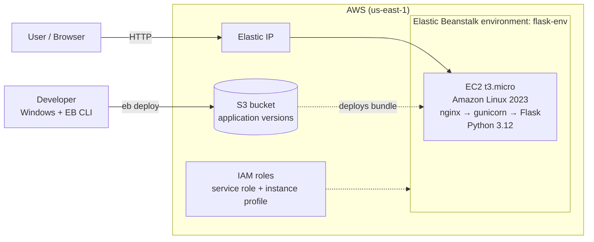
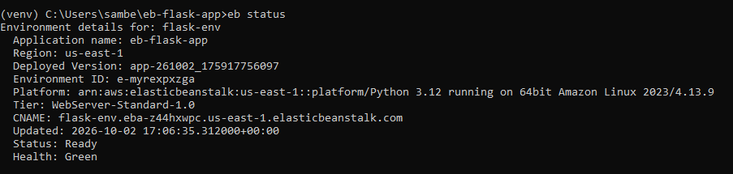

# Flask App on AWS Elastic Beanstalk

A simple Python Flask web application deployed to AWS Elastic Beanstalk using the EB CLI from a Windows machine. This project demonstrates deploying a WSGI application to managed AWS infrastructure, configuring it with environment variables, and monitoring it through logs and health checks.

## Architecture



**How it works:** `eb deploy` zips the project and uploads it to S3. Elastic Beanstalk provisions an EC2 instance with a security group and Elastic IP, installs the dependencies from `requirements.txt`, and starts the app using the command in the `Procfile`. Nginx on the instance forwards requests to gunicorn on port 8000, which serves the Flask app.

## Tech stack

| Layer | Technology |
|---|---|
| Language / framework | Python 3.12, Flask |
| App server | gunicorn |
| Hosting | AWS Elastic Beanstalk (single-instance environment) |
| Compute / storage | EC2 (t3.micro), S3 |
| Access control | IAM |
| Tooling | AWS CLI v2, EB CLI, Git, GitHub Actions, pytest |

## Project structure

```
.
├── .github/workflows/ci.yml   # runs tests on every push
├── .elasticbeanstalk/         # EB CLI configuration (no secrets)
├── docs/screenshots/          # deployment screenshots
├── tests/test_app.py          # route tests
├── application.py             # Flask app (callable named `application`)
├── Procfile                   # tells Beanstalk how to start gunicorn
├── requirements.txt           # runtime dependencies
├── requirements-dev.txt       # test dependencies
└── .ebignore                  # files excluded from the deployment bundle
```

## Endpoints

| Route | Response |
|---|---|
| `/` | HTML greeting showing the current `APP_ENV` |
| `/health` | `{"status": "ok"}` (JSON health check) |

## Run locally

```bash
python -m venv venv
venv\Scripts\activate
pip install -r requirements-dev.txt
python application.py
```

Open http://127.0.0.1:5000. Run the tests with `pytest`.

## Deploy to AWS

Prerequisites: an AWS account, an IAM user with Elastic Beanstalk permissions, and the AWS CLI and EB CLI installed.

```bash
aws configure                                   # enter IAM user credentials
eb init -p python-3.12 eb-flask-app --region us-east-1
eb create flask-env --single                    # single instance, no load balancer
eb status                                       # expect Health: Green
eb open                                         # open the app in your browser
```

Update and redeploy after changes:

```bash
eb deploy
```

Configure environment variables (never commit secrets):

```bash
eb setenv APP_ENV=production SECRET_KEY=<your-secret>
```

Inspect logs and health:

```bash
eb logs
eb health
```

## Screenshots

| App running | Environment health |
|---|---|
|  |  |

## Challenges and fixes

- **`eb` not recognized after installing with pip.** The EB CLI was installed, but its `Scripts` folder was not on the Windows PATH. Fixed by adding the Python `Scripts` directory to the user PATH (or using a virtual environment).
- **Beanstalk couldn't find the app.** The Elastic Beanstalk Python platform expects a WSGI callable named `application`, so the Flask object is `application`, not `app`, and the `Procfile` points to `application:application`.
- **Windows file-extension pitfalls.** Editors can save `Procfile` as `Procfile.txt`, which Beanstalk ignores. Verified exact file names with `dir`.
- **Dependency file encoding and bloat.** `pip freeze` in PowerShell can write UTF-16, which breaks deployment, and it also lists tools like `awsebcli`. I wrote a minimal `requirements.txt` by hand with pinned versions.
- **Credential safety.** Credentials stay in `~/.aws/`, outside the repo. Secrets are set with `eb setenv` and are never committed.

## Cost and cleanup

A single-instance environment (`--single`) avoids the cost of a load balancer. Resources bill hourly, so I tear everything down when finished:

```bash
eb terminate flask-env
```

I also deleted the `elasticbeanstalk-<region>-<account-id>` S3 bucket when I no longer needed it.

## What I learned

- How Elastic Beanstalk packages, uploads and deploys an application
- How `Procfile`, gunicorn and Beanstalk's nginx proxy fit together
- Managing configuration through environment variables
- Reading deployment and application logs to debug issues
- Basic AWS cost control

## Possible next steps

- Add a load-balanced, auto-scaling environment
- Add a custom domain with Route 53 and HTTPS with ACM
- Connect an RDS database
- Automate deployment with GitHub Actions
- Define the infrastructure as code with Terraform or CloudFormation

## License

MIT
